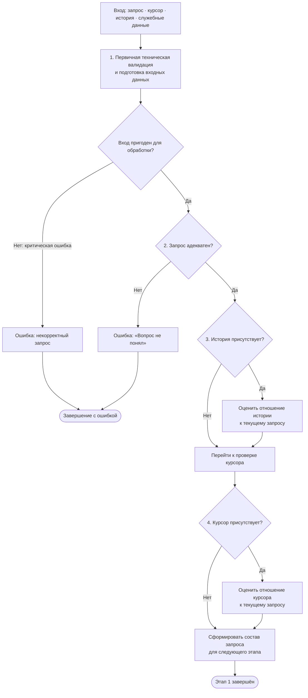

# Дерево обработки запроса — этап 1

Статус: **черновой каркас, согласованный на уровне грубых мазков**. Это описание целевого поведения, а не утверждение о текущей реализации кода.

## Назначение

Этап 1 принимает доступные входные данные, проверяет их техническую пригодность, затем определяет, какие из трёх смысловых источников следует учитывать дальше:

- текущий запрос пользователя;
- история диалога;
- курсор редактора.

Служебные данные (проект, сессия и прочее окружение) также входят во вход и проверяются/подготавливаются на первом узле.

## Дерево

## Узлы и правила

### 1. Первичная техническая валидация и подготовка входных данных

Детерминированно проверяет техническую пригодность входа и служебного окружения, загружает/нормализует то, что можно подготовить.

- Критическая ошибка, при которой продолжать нельзя (например, обязательный проект отсутствует или входные данные невозможно корректно разобрать), завершает запрос с ошибкой **«некорректный запрос»**.
- Отсутствие отдельного источника само по себе не является ошибкой.
- Полные и частичные подготовленные данные идут в один и тот же следующий узел.
- Узел не определяет смысл пользовательского намерения.

### 2. Проверка адекватности запроса

Если запрос неадекватен или непонятен, завершить обработку с ошибкой **«Вопрос не понял»**. На этом уровне не пытаемся спасать непонятный запрос историей или курсором и не разводим неоднозначность в отдельные исходы.

### 3. Проверка истории

Если история есть, отдельный узел оценивает, имеет ли она отношение к текущему запросу. Это смысловое решение может привлекать LLM.

История может быть принята, использована частично или отброшена. Наличие истории не означает, что она автоматически относится к вопросу.

### 4. Проверка курсора

Если курсор есть, отдельный узел оценивает, имеет ли он отношение **к текущему запросу**. Это смысловое решение может привлекать LLM.

**История не участвует в решении о релевантности курсора.** Отношение курсора к истории не оцениваем: критерий только один — связь курсора с текущим запросом.

Если курсор не относится к вопросу, это не ошибка: курсор исключается из дальнейшего рассмотрения.

### Выход этапа 1

Этап заканчивается сформированным составом запроса для следующих этапов:

- исходный запрос — прошёл проверку адекватности;
- история — применима / неприменима (если истории не было, она отсутствует);
- курсор — применим / неприменим (если курсора не было, он отсутствует);
- служебные данные проекта, сессии и окружения — подготовлены в пределах доступности.

На выходе фиксируется не просто наличие источников, а решение, какие из них допустимо учитывать дальше. Если запрос прошёл проверку, но история и курсор отсутствуют или отброшены, обработка продолжается с запросом и доступными служебными данными.

## Принципы этапа

1. Дерево переходов фиксировано; узлы принятия решений могут использовать LLM и не обязаны быть детерминированными.
2. Наличие источника и его смысловая применимость — разные проверки.
3. История и курсор проверяются отдельными последовательными узлами.
4. Результат проверки истории не влияет на решение о релевантности курсора.
5. Этот документ описывает только первый этап. Дальнейшие ветви пока намеренно не придумываются и не детализируются.
