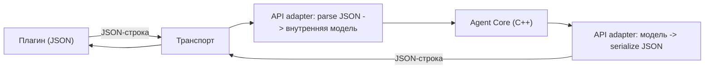

# fcpp-agent — описание агента для построения плагина (IDE/редактор)

Документ описывает **JSON-протокол** между плагином и агентом: что плагин отправляет,
что получает обратно и как ответ сериализуется для UI.

Составлен по спецификации (`tasks/requirements.md` §89, §41, §93, §94, §95).

---

## 1. Что такое агент

`fcpp-agent` — локальный C++/CMake-агент. Плагин IDE общается с ним через **Agent API**.
Плагин НЕ знает внутренних типов агента (Intent, Area, Relation, Tool, индекс, LLM).
Обмен — **сообщениями в JSON**; конкретный способ доставки (сокет/stdio/HTTP) —
отдельный транспорт (§41), ядро о нём не знает.

CLI, IDE и GUI — равноправные клиенты одного API.

---

## 2. Транспорт и сериализация

- Внутри агента сообщение представлено C++-структурами (внутренняя модель).
- **На границе транспорта** агент **сериализует** ответ в JSON и отдаёт плагину.
- Плагин работает **только с JSON** — C++-типов (`SApiResponse`, `EErrorKind`, `SSymbol` …)
  он не видит и знать не должен (§89.39 — граница API; §89.42 — JSON не проникает в ядро
  глубже адаптера).
- Рекомендуемый транспорт для плагина: **JSON-RPC поверх stdio или unix-socket**.
  Конкретный выбор — за адаптером; протокол сообщений от него не зависит (§41).



---

## 3. Граница: что плагин знает и отправляет

Для **пользовательских запросов** (`ask`) плагин знает и отправляет **только**:

```text
text    — текст запроса пользователя (обязательно, всегда)
file    — путь к открытому файлу (опционально; может отсутствовать)
cursor  — позиция курсора { line, column } (опционально; только вместе с file)
```

Плагин **НЕ** передаёт в `ask` `project_id`, `session_id`, `request_id`, состояния —
это внутренняя маршрутизация агента.

**НО:** агент не может «сам узнать», какой проект открыт, — ему это должно сообщить
окружение. Поэтому при **старте плагина** есть обязательный отдельный шаг — открытие
проекта (см. §3.1). Без него агент не знает ни корня проекта, ни индекса.

---

## 3.1. Открытие проекта (обязательный первый шаг)

При запуске плагин:
1. спрашивает у IDE корневую папку открытого проекта;
2. отправляет агенту JSON-запрос `open` с параметром `projectRoot`;
3. получает подтверждение (и, при необходимости, ждёт готовности индекса).

```json
{
  "id": "req-000",
  "method": "open",
  "params": { "projectRoot": "/home/user/projects/my_app" }
}
```

Ответ:

```json
{
  "id": "req-000",
  "result": { "state": "READY", "project_id": "project-7f31" }
}
```

- `params.projectRoot` — **абсолютный путь** к корню проекта (CMake-корень).
- `project_id` в ответе — **служебный идентификатор агента**; плагин может его сохранить
  и позже передавать в `ask` (необязательно), либо игнорировать — это внутренняя деталь.
- Если проект меняется (открыли другой) — плагин повторяет `open` с новым `projectRoot`.

События IDE, на которые реагирует плагин (примеры):
- `onProjectOpen(path)` → `open { projectRoot: path }`;
- `onProjectClose()`  → `close` (освободить проект в агенте);
- `onActiveEditorChange(file, cursor)` → обновляет контекст для следующих `ask`.

> Источник корня проекта — **IDE**, а не плагин: плагин лишь передаёт то, что даёт IDE.
> Это единственная «внешняя» информация об окружении, которую плагин сообщает агенту.

---

## 4. Запрос (`ask`, JSON, отправляет плагин)

Полный редакторский контекст:

```json
{
  "id": "req-001",
  "method": "ask",
  "params": {
    "text": "Почему здесь используется virtual?",
    "editor": {
      "file": { "path": "src/model/shape.hpp" },
      "cursor": { "line": 25, "column": 15 }
    }
  }
}
```

Минимум (без файла и курсора):

```json
{ "id": "req-002", "method": "ask", "params": { "text": "Что это за проект?" } }
```

Поля `params`:
- `text` — обязателен (строка).
- `editor` — опционален.
  - `editor.file.path` — путь к файлу (строка).
  - `editor.cursor.line` / `editor.cursor.column` — позиция (числа; только вместе с `file`).

Поля сообщения:
- `id` — идентификатор запроса, генерирует плагин; агент повторяет его в ответе.
- `method` — `"ask"` (основной метод).

---

## 5. Ответ (JSON, получает плагин)

### 5.1. Успех

```json
{
  "id": "req-001",
  "result": {
    "state": "COMPLETED",
    "answer": { "text": "Метод объявлен virtual, потому что..." }
  }
}
```

- `result.state` — состояние запроса: `COMPLETED`.
- `result.answer.text` — **готовый текст ответа** для отображения в UI.

### 5.2. Уточняющий вопрос (§22)

Если субъект неоднозначен, агент может вернуть вопрос со списком вариантов.
**Предлагаемый формат** (на доработку; см. §8):

```json
{
  "id": "req-003",
  "result": {
    "state": "CLARIFY",
    "question": "Уточните, что имеется в виду:",
    "options": [ "dogfood::model::Circle", "dogfood::model::Circle::Circle" ]
  }
}
```

**Текущая реализация (важно):** структурированного `state=CLARIFY` пока нет — уточнение
приходит как **обычная ошибка** (см. 5.3) с текстом списка в `error.message`. Плагин
должен уметь показать этот текст; распознавание списка — эвристикой по тексту.

### 5.3. Ошибка

```json
{
  "id": "req-001",
  "error": {
    "code": "PROJECT_NOT_OPEN",
    "message": "Shared state is not open. Call project.open first.",
    "details": {}
  }
}
```

- `error.code` — строковый код (плагин трактует как непрозрачную строку).
- `error.message` — человекочитаемый текст (для UI).
- `error.details` — дополнительная информация (объект; сейчас пусто).

### 5.4. Долгая операция (§89.14)

Для длительных операций — подтверждение старта, результат — событиями:

```json
{ "id": "req-040", "result": { "request_id": "req-040", "state": "RUNNING" } }
```

События: `request.started`, `request.interpretation`, `request.progress`, `request.completed`.

**Текущая реализация:** поток событий не реализован — `ask` отвечает синхронно (5.1).

---

## 6. Сериализация ответа для UI

Ответ агента уже сериализуется в JSON на границе API-адаптера. Для плагина это означает:

1. Пришла JSON-строка → распарсить → взять `result.answer.text` (или `error.message`).
2. Отобразить текст в UI (панель ответа/чат).
3. Если `state == "RUNNING"` (будущее) — открыть подписку на события.

**Что соответствует внутренним полям агента** (для понимания, плагину не нужно):
- `result.answer.text` ← внутреннее поле `m_text` (ответ модели/сообщение);
- `result.state` ← внутреннее состояние запроса;
- `error.code` ← внутренний `m_error`; `error.message` ← внутренний `m_message`.

Внутренние C++-типы (`SApiResponse`, `EErrorKind`, `SIndexStatus`, `SSymbol`,
`SSymbolLocation`) — **деталь реализации**; в протокол для плагина они не попадают.

---

## 7. Методы API (JSON `method`)

```text
open / close                    — открыть/закрыть проект (projectRoot)
status                          — состояние проекта/индекса
ask                             — пользовательский AI-запрос (основной)
index.status/refresh/rebuild    — управление индексом
build / tests                   — сборка/тесты
tool <name> <target>            — детерминированные запросы к индексу
patch                           — применить unified diff
doctor                          — проверка окружения
agent.status / capabilities     — служебные
```

Соответствие внутренним методам агента (для разработчика): `open`/`close` -> `project.open`/`project.close`,
`status` -> `project.status`, `tool` -> детерминированный запрос, `ask` -> `EApiMethod::Ask`.
Плагин использует строковые имена методов ("open", "ask", ...); конкретные строки —
часть контракта протокола и должны быть согласованы.

---

## 8. Минимальный сценарий интеграции плагина

```text
1. IDE сообщает плагину корень проекта (onProjectOpen)
2. open { projectRoot: "/abs/path" }     — обязательный первый шаг
3. (опц.) status                          — дождаться ready
4. ask { text, editor }                   — пользовательский запрос
5. показать result.answer.text            — либо ошибка/уточнение (error.message)
```

Плагину достаточно: **open(projectRoot)** при старте, далее **файл + курсор + текст** -> `ask`.

---

## 9. Инварианты

- Плагин не передаёт `Area/Relation/Projection/Tool/target/project_id/session_id` —
  это внутренние сущности и маршрутизация (§89.39).
- Изменение внутренней классификации (декомпозиция, разрешение курсора, Relation)
  не требует правок плагина (§89.39).
- Транспорт независим (§41): плагин не завязан на конкретный способ доставки.

---

## 10. Известные ограничения (кандидаты на доработку)

- Нет отдельного процесса/транспорта (`fcpp serve`) — вызов in-process.
- Нет event-stream (`request.*`) — ответ синхронный.
- Уточнение не структурировано (нет `state=CLARIFY` + `options[]`); сейчас — текст в `error.message`.
- `session_id`/`request_id` не первоклассны.
- JSON-схема ответа (`result.state`, `answer.text`, `error.code`) в коде пока не оформлена
  как стабильный контракт — требуется сериализатор на границе API.
