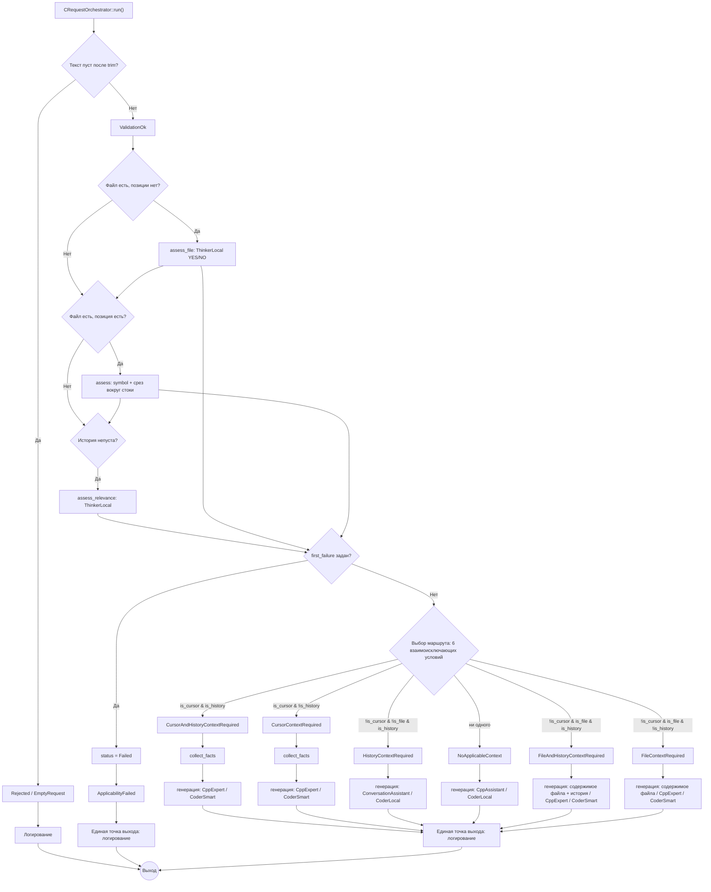

# План переработки архитектуры обработки запросов

Статус: целевая архитектура и план работ. Код пока не меняется.

## Цель

Полностью заменить верхнеуровневую логику обработки запросов. Не сохранять `CAskService` в роли центра архитектуры и не переносить его ветвления механически. Старый код — источник отдельных механизмов, которые повторно оцениваются на соответствие новым контрактам.

Главный принцип: **только оркестратор управляет маршрутом пользовательского запроса**. Инструменты выполняют порученные операции и возвращают результаты, но не перенаправляют запрос самостоятельно.

## Сущности и ответственность

### Входной фасад
Физически взаимодействует с IDE/клиентом: принимает сообщение, проверяет транспортный формат, при необходимости нормализует данные, вызывает оркестратор и возвращает результат в формате клиентского протокола. Не классифицирует смысл запроса и не выбирает контекст или стратегию.

### Оркестратор
Новая центральная сущность. Проверяет понятность запроса; отдельно определяет применимость истории и курсора; выбирает инструменты; проверяет результаты; решает, достаточно ли данных; формирует контекст; выбирает стратегию и роль модели; возвращает итог. Не реализует внутренние операции специалистов.

### LLM Runtime
Общий технический слой вызова моделей. Вызывающая сущность передаёт уже подготовленные данные и явно выбранную роль. Runtime не выбирает модель, не формирует промпт/контекст, не оценивает смысловую корректность и не выбирает следующий шаг.

Предварительные роли:
- `LocalCoder` — локальная модель для простых операций с кодом;
- `SmartCoder` — более мощная модель для сложной работы с кодом;
- `LocalThinker` — локальный анализ и структурированные решения;
- `SmartThinker` — сложные рассуждения.

Роли логические: конфигурация сопоставляет их конкретным моделям, endpoint и параметрам. Список может расширяться независимо от вызывающих компонентов.

Обязанности Runtime: ограничения входного контекста и вывода, потоковая передача, технические ошибки/тайм-ауты/повторы, нормализация технической формы результата, телеметрия. Формирование промпта и выбор роли остаются у вызывающей сущности.

### Специализированные сущности
- **Историк** — извлекает и оценивает применимость истории. Для локальной задачи может обращаться к LLM Runtime.
- **CodebaseKnowledge** — единая система знаний о кодовой базе. Скрывает внутреннюю реализацию (БД, индекс, clangd, файловые механизмы и др.); оркестратор запрашивает операции и не выбирает источник напрямую.
- **Анализаторы** — ограниченные задачи: понятность, применимость истории/курсора, область вопроса, декомпозиция. Могут использовать LLM Runtime, но возвращают результат анализа, а не новый маршрут.
- **ReAct-исполнитель** — отдельная делегируемая сущность со своим ограниченным циклом работы с разрешёнными инструментами. Оркестратор выбирает, когда его запускать, задаёт границы и оценивает итог.
- **Сборка контекста** — объединяет выбранные данные и проверяет бюджет. Не выбирает маршрут и не подменяет исходный вопрос собранным контекстом.
- **Формирование ответа** — стратегия выбирается оркестратором: прямой вызов модели, доказательный ответ или ReAct. Ответчик не маршрутизирует пользовательский запрос заново.

Инструменты не собирают весь контекст самостоятельно и не перехватывают управление запросом.

## Контракты CodebaseKnowledge

Предварительный набор статусов операции:
- `Success` — операция выполнена согласно своему контракту;
- `NotFound` — искомые данные штатно не найдены;
- `Ambiguous` — найдено несколько допустимых вариантов;
- `Unavailable` — недоступна необязательная возможность, если это разрешено контрактом;
- `Error` — операция не завершилась корректно.

Конкретная операция определяет допустимые статусы. Статус описывает результат операции, а не смысловую применимость к вопросу.

Гарантии:
- `Success` означает, что результат соответствует контракту.
- Если операция обещает найти **все** совпадения, тихое усечение до первых 20 недопустимо. Ограниченный поиск — отдельная операция с явным ограничением.
- Отсутствие данных не равно невозможности их получить.
- Не добавлять в общий результат поля об источнике, проекте, полноте или диагностике без конкретной необходимости.
- Диагностика технических сбоев в первую очередь пишется в лог.

Недоступность обязательной инфраструктуры (например, обязательной БД) — критический сбой, а не штатный `Unavailable`. Ошибка логируется, операция прекращается; нельзя продолжать так, будто данные просто не найдены. Продолжать разрешено только при явно признанных некритическими отказах. Техническая достоверность результата отделяется от смысловой применимости.

## Протокол инициализации проекта

До обработки пользовательских запросов агент обязан успешно завершить открытие проекта. Любая ошибка на обязательном этапе немедленно завершает инициализацию с `ERROR`; последующие этапы не выполняются.

### Последовательность

1. **Проверка каталога проекта**
   - Получить путь от IDE.
   - Проверить, что путь существует, доступен и указывает на каталог.
   - Пустой каталог отклонить: создание нового проекта пока не поддерживается.
   - Любая ошибка проверки — `ERROR` с кодом этапа.

2. **CMake и имя проекта**
   - Проверить наличие читаемого `CMakeLists.txt` в корне.
   - Прочитать из него имя проекта через объявление `project(...)`.
   - Если файл отсутствует, не читается или имя проекта не удалось определить, вернуть `ERROR`.

3. **Каталог сборки и `compile_commands.json`**
   - Проверить каталог `build`; если его нет, создать.
   - На каждом открытии проекта запускать конфигурацию CMake с экспортом compile commands, чтобы `build/compile_commands.json` был актуален. Если файл уже есть, обновлять его без дополнительного вопроса.
   - Если каталог нельзя создать, CMake завершился с ошибкой или JSON не создан/не читается/некорректен — немедленно вернуть `ERROR`.
   - Не продолжать с отсутствующим или устаревшим файлом как будто всё успешно.

4. **База данных**
   - Подключиться к существующей БД проекта либо создать новую.
   - Для новой БД создать актуальную структуру напрямую из `schema/current.sql`. Для существующей БД только проверить наличие обязательных таблиц; при несовпадении вернуть `ERROR`, не менять схему и не подстраиваться под неё.
   - Проверить, что подключение и обязательная структура доступны.
   - Любая ошибка подключения, создания или проверки структуры — `ERROR`; не маскировать её под отсутствие данных.

5. **Сессия и подтверждение готовности**
   - Только после успешного завершения предыдущих этапов восстановить актуальную сессию проекта или создать новую.
   - Вернуть IDE `READY`, `project_id` и `session_id`.
   - При ошибке вернуть `ERROR`, код этапа и диагностическое сообщение. Не возвращать `READY` частично подготовленному проекту.

### Диагностика

Каждый этап открытия логируется с общим `request_id`, корнем проекта и названием этапа. Успешное завершение фиксируется отдельно от ошибки. При ошибке логируются этап, код/причина и путь к ресурсу, если он известен. После первой обязательной ошибки дальнейшая инициализация прекращается.

## Дерево обработки

### A. Вход и понятность
1. Фасад принимает и нормализует транспортное сообщение.
2. Оркестратор проверяет технические предпосылки обработки.
3. Анализатор определяет, понятен ли сам запрос.
4. Непонятный запрос завершается уточнением. Не спасать его историей или курсором.

### B. Применимость контекста
5. Если история есть, отдельно оценить её отношение к текущему запросу.
6. Если курсор есть, отдельно оценить его отношение к текущему запросу.
7. Релевантность курсора оценивается независимо от истории.
8. Зафиксировать один из вариантов: нет применимых источников; только курсор; только история; оба применимы.

### C. Область вопроса
9. Если история и курсор неприменимы, определить, требует ли запрос знаний о конкретной кодовой базе.
10. Общий вопрос идёт коротким путём: запрос → выбранная роль модели → Runtime → ответ.
11. Запрос о кодовой базе переходит к сбору необходимых фактов.

### D. Получение данных
12. Оркестратор формирует конкретные задания для историка, CodebaseKnowledge и других инструментов.
13. Каждый инструмент возвращает результат по своему контракту.
14. Оркестратор проверяет статусы и достаточность. Критические сбои не маскируются под отсутствие данных.
15. Используются только применимые и технически пригодные результаты.

### E. Контекст и ответ
16. Контекст собирается отдельно от исходного вопроса; вопрос сохраняется как самостоятельные данные.
17. Оркестратор выбирает прямой вызов модели, доказательный ответ или ReAct.
18. Ответ проверяется на соответствие доступным данным и контракту.
19. Фасад возвращает результат клиенту.

Детальные условия переходов, повторные вызовы и политика уточнения определяются до реализации.

## Фактическая реализация дерева

Диаграмма отражает текущий код, а не проектный замысел.

Флаги выбора маршрута: `is_cursor`, `is_file`, `is_history`. Условия
взаимоисключающие, порядок проверок ни на что не влияет.

Ключевые отличия от первоначального замысла:

- **Шесть маршрутов.** Добавлен `FileContextRequired` (файл без позиции курсора)
  и `FileAndHistoryContextRequired` (файл без позиции и история). Условия
  выбора взаимоисключающие: `is_cursor`, `is_file`, `is_history`.
- **Файл без курсора — не «нет контекста».** Если редактор прислал файл, но не
  прислал позицию, это отдельный случай: модель-мыслитель строго YES/NO решает,
  относится ли вопрос к этому файлу. При YES в промпт уходит содержимое файла
  (любой тип: `.cpp`, `.h`, `.md`, `.txt`), при NO запрос завершается видимой
  причиной `FileNotRelevant` с записью в лог, а не молчаливым общим ответом.
- **Оценки независимы.** Курсор и история оцениваются всегда; ошибка одного
  фиксируется в `first_failure`, но не прерывает второй анализ. Сбой `clang`
  не лишает запрос применимой истории.
- **Факты заказывает оркестратор.** На курсорных маршрутах перед генерацией
  выполняется `collect_facts` по сущности под курсором. Недоступность индекса —
  `IndexUnavailable`, а не «нет контекста».
- **Заглушек нет.** `ScopeClassificationNotImplemented` и `StubComplete` удалены
  как мёртвый код: значения не выставлялись ни на одном пути. Все четыре
  маршрута формируют реальный ответ.
- **`route` не врёт при сбое.** До выбора маршрута значение —
  `Unselected`; при сбое оно таковым и остаётся, а не маскируется под
  `NoApplicableContext`.
- **Единая точка выхода.** `request.finished` пишется на всех путях, включая
  ранние отказы и сбои инструментов.

## План работ

1. **Детализировать дерево.** Определить все переходы, штатные исходы, уточнения и ошибки; составить сценарии тестирования.
2. **Зафиксировать контракты.** Внутренний запрос/ответ, LLM Runtime и роли, историк, CodebaseKnowledge, анализаторы, ReAct, сборка контекста.
3. **Инвентаризировать старый код.** Для каждого компонента определить, что переиспользовать, адаптировать или заменить. Не сохранять `CAskService` как архитектурный центр. Проверить зависимости до удаления компонентов.
4. **Реализовать LLM Runtime.** Роли и конфигурационное сопоставление; поток, лимиты, ошибки, тайм-ауты, повторы и телеметрия. Не переносить сюда построение промптов и выбор стратегии.
5. **Реализовать CodebaseKnowledge.** Описать операции и гарантии; проверить разрешение символов, полноту поиска, неоднозначность и критические зависимости; покрыть тестами штатные и ошибочные исходы.
6. **Реализовать инструменты.** Историк, анализаторы и отдельный ReAct-исполнитель с ограниченными полномочиями.
7. **Реализовать оркестратор.** Следовать утверждённому дереву, проверять результаты, собирать контекст только из выбранных данных.
8. **Перенести тесты и удалить старую маршрутизацию.** Сравнить сценарии на фиксированных входах; удалять старые ветки только после покрытия их полезной функциональности; проверить сборку, тесты и IDE smoke-сценарии.

## Критерии готовности

- Единственный владелец маршрута пользовательского запроса — оркестратор.
- Фасад не выполняет смысловую маршрутизацию.
- Вызывающая сущность явно выбирает роль модели; Runtime не выбирает её сам.
- Промпт и контекст формируются вне Runtime.
- Инструменты не перенаправляют пользовательский запрос.
- ReAct — отдельный делегируемый исполнитель.
- CodebaseKnowledge скрывает внутренние источники и соблюдает контракты операций.
- Критические сбои не выдаются за отсутствие данных или успешный результат.
- Полнота определяется контрактом; тихое усечение запрещено.
- Дерево покрыто тестами, включая уточнения, отсутствие данных, неоднозначность и критические сбои.

## Открытые решения

- Точные DTO запроса и ответа.
- Окончательный набор ролей и формат конфигурации.
- Точные границы между анализаторами, оркестратором и сборщиком контекста.
- Перечень операций CodebaseKnowledge и их гарантии.
- Условия выбора ReAct вместо прямого вызова.
- Политика восстановления после некритических ошибок.

Решения уточняются при проектировании конкретных контрактов, а не добавляются заранее «на всякий случай».
